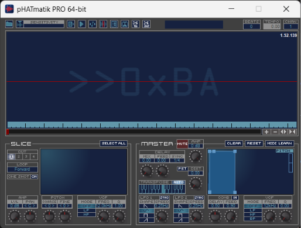

#  Phatmatik PRO on 64-bit Windows

Makes the legacy iZotope Phatmatik PRO v1.52 plug-in usable in 64-bit Windows audio hosts, and packages it as a one-file installer.

This is an unofficial project. It is not made, endorsed or supported by iZotope.

**Bring your own installer.** This project does not include iZotope's software. You need your own copy of the legacy installer, the file named `iZotope_pHATmatik_PRO_v1_52.exe`. From this folder, run:

```powershell
.\build.ps1 -Installer "C:\path\to\iZotope_pHATmatik_PRO_v1_52.exe"
```

That one command checks the file, builds the 64-bit setup, and tells you the program to double-click. The steps are under [Install](#install).

**Validated on 64-bit Windows 11 with FL Studio 2026.** What that covers is listed under [What has been validated](#what-has-been-validated).

## Install

A copy of this project does not include iZotope's plug-in. You supply one file, `iZotope_pHATmatik_PRO_v1_52.exe`. `build.ps1` checks that file and builds the 64-bit setup on your machine.

A clone does not contain `extracted\` or `build\`. Both are listed in `.gitignore`, and GitHub does not keep an empty folder. `dist\` is missing too unless the repository has some other file in it. The script creates all three before it checks your installer.

**You need:**

- 64-bit Windows (validated on Windows 11).
- A 64-bit DAW that loads VST2 plug-ins (validated with FL Studio 2026).
- Your own copy of iZotope's installer for pHATmatik PRO v1.52, named `iZotope_pHATmatik_PRO_v1_52.exe`.
- Visual Studio 2022 Build Tools, with the C++ compilers for x86 and x64. The script compiles the bridge on your machine.
- A Phatmatik PRO serial number. Without one, the plug-in runs as a full trial for 10 days.

### 1. Open PowerShell in this folder

The commands below are run from the folder that contains `build.ps1`.

### 2. Give the script your installer

Use either of these. The file name the project uses is exactly `iZotope_pHATmatik_PRO_v1_52.exe`.

**Pass the path of the file you already have:**

```powershell
.\build.ps1 -Installer "C:\path\to\iZotope_pHATmatik_PRO_v1_52.exe"
```

Replace the example path with the real path of your installer. The script copies it to `dist\iZotope_pHATmatik_PRO_v1_52.exe`. Your original file is not modified.

**Or copy it into the project yourself**, then run the script with no arguments:

```powershell
.\build.ps1
```

The copy has to be at `dist\iZotope_pHATmatik_PRO_v1_52.exe`. If `dist\` does not exist yet, run the command above once. The script creates `dist\` and then tells you that the installer is missing. Copy the file to that path and run `.\build.ps1` again.

### 3. What the script does

On a run that accepts the installer, the messages are `Preparing folders`, then `1/4` through `4/4`:

1. Creates these folders if they are missing: `dist\`, `extracted\`, `build\`, `build\x64\`, `build\x86\`, `build\obj\`, `build\test\`.
2. Checks the file. It has to be a Windows program, and its SHA-256 has to be `9205FA07ABB6B5388B2DBA0D1C0638AA8E3918D062F5CAD99428467663BB6A9E`. That is iZotope pHATmatik PRO v1.52.
3. Unpacks it into `extracted\`.
4. Compiles the 64-bit bridge into `build\`.
5. Writes `pHATmatik_PRO_v1_52_x64_Setup.exe` in this folder. That is the setup program you double-click. It also writes `dist\pHATmatik_PRO_x64_Bridge_Only_Setup.exe`, which contains the bridge and none of iZotope's files.

If the script stops, the message says why. A missing path, a folder, a file that is not a Windows program, and a program that is not v1.52 are refused. For that last case it prints the SHA-256 above and the SHA-256 of the file you gave. The folders from item 1 stay in place.

### 4. Install the setup program

1. Double-click **`pHATmatik_PRO_v1_52_x64_Setup.exe`** in this folder.
2. Click **Yes** when Windows asks to allow changes.
3. Accept the licence and click **Next** until the wizard asks for the **64-bit VST Plug-ins Folder**. Keep the suggested folder unless your DAW looks for VST2 plug-ins somewhere else.
4. Click **Next**, then **Install**. When it has finished, click **Next** and **Finish**.

The one installer sets up everything: the original plug-in and the 64-bit bridge that lets your DAW load it. Running it again later updates the bridge and leaves the rest alone.

## Use it

1. Open your DAW and make it rescan its VST2 plug-ins. In FL Studio: **Options → Manage plugins → Find installed plugins**.
2. Add **iZotope pHATmatik PRO** to your project. In FL Studio it goes on the channel rack and is listed as "32+64" bits.
3. The **iZotope Authorization** window appears until the plug-in is authorized. Click **Authorize** and enter your serial number, or click **Continue** to use the trial.

If the DAW seems frozen right after step 2, the authorization window is hiding behind it. Find it with Alt+Tab.

### Load your first loop

1. Click the **folder button** at the top left of Phatmatik. A file browser opens on the right.
2. In the upper list, click a folder **once** to open it. Let the pointer rest on the row before you click. The list does not scroll with the mouse wheel; drag its scrollbar.
3. In the lower list, **double-click** a loop to load it. WAV, AIFF and pHATfiles load.
4. Click the **slice button**, the second button in the toolbar, just left of the sensitivity slider. The loop is cut into slices. ("Select All" only selects slices; it does not make them.)
5. Play the slices with MIDI notes. Each slice shows its note on its marker; the first is MIDI note 48, which FL Studio calls **C4**. An unsliced loop is one slice on that note.

To hear the loop without any notes, press the **play button** in the plug-in's toolbar and start your DAW's transport.

### Get the groove into your DAW

- **Drag it:** hold **Alt**, press the **MIDI export button** (the first button after the sensitivity slider) and drag into your DAW. In FL Studio, drop it on the **channel rack**; FL Studio then asks how to import it and fills the pattern with one note per slice.
- **Or save it:** click the same button without Alt and save a MIDI file.

Your project remembers the plug-in's state. Save it, and the loop and its slices are back when you reopen it.

## Remove it

Open Windows **Settings → Apps → Installed apps** and uninstall both entries:

- **pHATmatik PRO 64-bit Bridge**
- **iZotope pHATmatik PRO**

## If something goes wrong

| What you see | What to do |
| --- | --- |
| The plug-in is not in the DAW's list | Rescan, and check that the DAW scans the 64-bit folder chosen during installation. |
| The DAW freezes when the plug-in loads | The authorization window is behind the DAW. Press Alt+Tab to find it. |
| No sound, and you are on the trial | The plug-in is silent if it loaded without showing the authorization window. Remove it, wait a minute, add it again and click **Continue**. |
| No sound from your notes | Slice the loop first, then use MIDI notes from 48 upwards (C4 in FL Studio). |
| Dragged MIDI does not arrive in FL Studio | FL Studio's playlist does not take MIDI files. Drop on the channel rack instead. |
| The DAW freezes while you drag MIDI out of the plug-in | You have bridge 1.0.0. Run the current installer again; 1.0.1 fixes it. |
| "Save as pHATfile" saved under another name | The plug-in always uses the loop's own name, in the folder its dialog opened in. |
| Dragged-out slices are missing | The plug-in writes no slice files on this system, with or without the bridge. Record the plug-in's output instead. |
| The installer says the folder "already contains a file ... that is not the bridge" | You picked the folder of your 32-bit plug-ins. Pick the folder your 64-bit DAW scans. |
| `build.ps1` says there is no file at the path you gave | `-Installer` has to be the path of the `.exe` file. A folder path is refused. |
| `build.ps1` prints two SHA-256 lines and stops | The file is not iZotope pHATmatik PRO v1.52. The first hash is the installer this project accepts. |

More cases, and where the bridge writes its error log, are in [debug/troubleshooting.md](debug/troubleshooting.md).

**Giving this to someone else?** Send `dist\pHATmatik_PRO_x64_Bridge_Only_Setup.exe`, not the main installer. The reason is under [Sharing the installer](#sharing-the-installer).

---

# Project details

Everything below is for people working on the project. You do not need it to install or use the plug-in.

## What has been validated

Version 1.0.1, on 64-bit Windows 11, as of 2026-11-13.

**In FL Studio 2026 (64-bit):**

- The plug-in scan finds it, and FL Studio loads it through this project's bridge.
- Its window opens inside FL Studio and resizes when the built-in browser is opened.
- A loop loads from the browser and slices; notes from the piano roll and the keys play the slices; play preview plays the loop.
- MIDI exports through the plug-in's Save dialog, and by Alt + drag onto the channel rack.
- Two instances run in one project.
- A saved project reopens with the sliced loop intact.

**Against the original, sample for sample.** Every test runs twice, with the original 32-bit plug-in loaded directly and through the bridge, and the results must be identical:

- Sound from a sliced loop: all 48 parameters, the 16 programs, sample rates of 22.05, 48 and 96 kHz, block sizes from 1 to 40,000 samples, parameter changes during playback, six instances at once, and a soak of about 39 minutes of audio.
- Preset state saved, restored into a fresh instance, and played.
- On screen with real mouse and keyboard input: loading WAV, AIFF and pHATfiles, slicing, play preview, knob drags reaching the host, the browser resize, MIDI export, MIDI dragged to the host, and Save as pHATfile. Files written are byte-identical.

**Robustness:** if the helper process dies the host keeps running and the plug-in goes silent; if the host dies no helper is left behind; a missing or wrong plug-in file is refused with the reason logged; 25 editor open and close cycles leave nothing behind.

**The installer:** a fresh install with administrator rights (iZotope's installer run silently inside it), an install of 1.0.1 over 1.0.0, a per-user install and uninstall, and its refusal to overwrite the original plug-in. The installers are reproducible: the same binaries give byte-identical files.

## Why a bridge and not a recompile

iZotope's original `iZotope_Phatmatik_PRO_v1_52.exe` (kept in `dist\`) is only an installer, and it installs only the 32-bit plug-in. The product inside it is a 32-bit VST 2.4 plug-in DLL from 2007 with no source and no symbols. A 64-bit host cannot load a 32-bit DLL.

Rebuilding that DLL from decompiled code would take months, could not be shown to sound the same, and would mean rewriting or removing iZotope's copy protection. The bridge avoids all three: the original DLL runs unmodified, in a 32-bit process, and a new 64-bit plug-in relays everything between it and the host.

## How it works

```
64-bit host
  └─ iZotope Phatmatik PRO.dll            the bridge: a 64-bit VST2 plug-in (new code)
       │  pipes: calls, parameters, presets, MIDI      shared memory: audio
  PhatmatikBridgeHost32.exe               32-bit helper process, one per plug-in instance (new code)
  └─ iZotope Phatmatik PRO.dll            the original 32-bit plug-in, unmodified
       └─ REX Shared Library.dll          Propellerhead's 32-bit REX loader, unmodified
```

- **Audio** goes through a shared memory block; in the tests each processing call cost roughly 15 to 40 microseconds on top of the plug-in's own time.
- **The editor** is the original plug-in's window, created by the helper as a child of the host's window.
- **Projects** carry the same plug-in ID (`ppro`) and the same preset data as with the 32-bit plug-in.
- **Licensing** is untouched. The plug-in's own authorization window appears and behaves as it does on a 32-bit system.
- **If the helper dies**, the bridge goes silent instead of taking the host down. If the host dies, the helper is killed with it.

The bridge finds the helper and the original DLL from the registry key the installer writes (`SOFTWARE\Phatmatik PRO Bridge` in HKLM, or HKCU for a per-user install). A file with the bridge's name and the extension `.ini` next to the bridge DLL overrides that; the tests use this.

## The installers

Built by `installer\build-installer.ps1`:

| File | Contains | For |
| --- | --- | --- |
| `Phatmatik_PRO_v1_52_x64_Setup.exe` (this folder) | iZotope's original installer (unmodified) and the bridge | Your own machines. This is the main installer. |
| `dist\Phatmatik_PRO_x64_Bridge_Only_Setup.exe` | The bridge only, no iZotope files | Giving to other people |

The main installer shows iZotope's licence, runs iZotope's installer silently (skipped if the plug-in is already installed), asks for the 64-bit VST2 folder, and installs the bridge. The bridge-only installer needs the original plug-in to be installed already, or iZotope's installer to sit next to it.

Both refuse to write the bridge over the original DLL (the two files share a name). Both are unsigned.

Command-line options, besides Inno Setup's own (`/SILENT`, `/VERYSILENT`, `/SUPPRESSMSGBOXES`, `/LOG=`):

| Option | Meaning |
| --- | --- |
| `/VST64DIR="folder"` | 64-bit VST2 folder for the bridge |
| `/PLUGIN32="file"` | Use this existing 32-bit DLL; iZotope's installer is not run |
| `/CURRENTUSER` | Install without administrator rights, for the current user only |

### Sharing the installer

iZotope's licence for Phatmatik PRO ([extracted/app/License_en.rtf](extracted/app/License_en.rtf)) allows use on one computer and one backup copy. It does not grant the right to distribute the software. The main installer contains iZotope's software, so passing it to other people is distributing it. The bridge-only installer contains none of it and is the one to share; each recipient supplies their own copy of iZotope's installer.

`dist\` holds the bridge-only installer and, when you supply it, iZotope's original installer. Share the one file, `pHATmatik_PRO_x64_Bridge_Only_Setup.exe`, not the folder.

## Files that are not in the repository

`.gitignore` leaves these out. GitHub does not keep an empty folder, so `extracted\` and `build\` are absent from a clone until `build.ps1` creates them. `dist\` is created the same way when the clone does not already have it. Your own `iZotope_pHATmatik_PRO_v1_52.exe` is the only file that script cannot create.

| Path | What it is | How you get it |
| --- | --- | --- |
| `dist\iZotope_pHATmatik_PRO_v1_52.exe` | iZotope's v1.52 installer. The script copies your file here, under this exact name, and does not modify your original. | `.\build.ps1 -Installer "C:\path\to\iZotope_pHATmatik_PRO_v1_52.exe"` |
| `extracted\` | The unpacked installer. The main setup shows `extracted\app\License_en.rtf` as its licence page, and `tests\compare.ps1 -Phatmatik` loads the plug-in DLL from here. | `build.ps1`, or `scripts\unpack-installer.ps1` once the file above is in `dist\` |
| `build\` | The compiled bridge, helper, and test tools. | `.\build.ps1`, which fills this folder while it builds the setup. `.\build.ps1 -CompileOnly` compiles and stops there. |
| `pHATmatik_PRO_v1_52_x64_Setup.exe` | The setup program to double-click. It contains your copy of iZotope's installer and the bridge. | `build.ps1` |

`build.ps1` also writes `dist\pHATmatik_PRO_x64_Bridge_Only_Setup.exe`. That one contains no iZotope files. innoextract 1.9, which does the unpacking, is included at `tools\innoextract`.

The script stops before it copies or builds if the file you gave is missing, is a folder, is not a Windows program, or is not pHATmatik PRO v1.52. For that last case it prints the SHA-256 it expects, `9205FA07ABB6B5388B2DBA0D1C0638AA8E3918D062F5CAD99428467663BB6A9E`, and the SHA-256 of the file you gave.

## Building and testing

Requirements: Visual Studio 2022 Build Tools with the C++ x86/x64 compilers, and Inno Setup 6 (a portable copy is in `tools\InnoSetup`). innoextract 1.9 is included at `tools\innoextract`.

```powershell
.\build.ps1 -Installer "C:\path\to\iZotope_pHATmatik_PRO_v1_52.exe"  # the whole deployment
.\build.ps1 -CompileOnly           # compile into build\ only
.\tests\compare.ps1                # validation plug-in: direct vs bridged, bit for bit
.\tests\robustness.ps1             # helper crash, host crash, 8 instances, bad configuration
.\tests\compare.ps1 -Phatmatik     # the original DLL: direct vs bridged
.\tests\real-audio.ps1             # installed product: real Phatmatik sound, direct vs bridged
.\tests\features.ps1               # installed product: parameters, programs, sample rates, instances (add -Soak)
.\tests\gui.ps1                    # installed product: on-screen features, with the real mouse (hands off!)
```

`features.ps1` and `gui.ps1` take `-UseBuild` to test the bridge in `build\` instead of the installed one. `gui.ps1` moves the real pointer and answers the plug-in's dialogs for about four minutes; do not touch the mouse or keyboard while it runs.

The tests run each plug-in twice: loaded directly by a 32-bit test host, and loaded through the bridge by a 64-bit test host. Everything the host can observe must match exactly. `testplug32.dll` is a small plug-in written for this purpose; it produces sound, MIDI and host callbacks without needing a licence.

### Trying it without a DAW

Double-click `build\x64\Phatmatik PRO 64-bit.exe`. It opens the installed plug-in, through the bridge, in a window of its own and plays its output on the default sound device until the window is closed. Load a loop as described under [Load your first loop](#load-your-first-loop) and press the plug-in's play button to hear it; this program sends no MIDI.

It is the test host built without a console: a convenience for trying the plug-in, not a DAW, and the installer does not install it. Its window and taskbar icon is `images\app-icon.png`, a drawing made for this project by `tools\draw-app-icon.ps1`; the build turns it into a multi-size icon with `tools\make-icon.ps1`.

## Layout

| Path | Purpose |
| --- | --- |
| `pHATmatik_PRO_v1_52_x64_Setup.exe` | **The installer to run.** Produced by `build.ps1`. Left out of the repository. |
| `dist/iZotope_pHATmatik_PRO_v1_52.exe` | iZotope's original installer. You supply this file. Left out of the repository. Never modify it. |
| `dist/pHATmatik_PRO_x64_Bridge_Only_Setup.exe` | The bridge-only installer, also produced by `build.ps1`. |
| `build.ps1` | The deployment command. Checks your installer, creates the missing folders, unpacks, compiles, and writes both setup programs. |
| `scripts/unpack-installer.ps1` | Unpacks `dist\iZotope_pHATmatik_PRO_v1_52.exe` into `extracted\`. |
| `extracted/` | That payload. Left out of the repository. Do not edit it by hand. |
| `src/bridge64/` | The 64-bit bridge plug-in. |
| `src/host32/` | The 32-bit helper process. |
| `src/common/` | Protocol (`ipc.h`), VST2 interface definitions (`vst2.h`), version resource. |
| `src/testhost/`, `src/testplug/` | Test host and validation plug-in. |
| `tests/` | Test scripts. |
| `installer/` | Inno Setup script, wizard texts, installer build script. |
| `build/` | Build output (generated). Left out of the repository. |
| `tools/InnoSetup/` | Portable Inno Setup 6.4.3. |
| `tools/innoextract/` | innoextract 1.9, used to unpack iZotope's installer. Its licence is in that folder. |
| `tools/draw-app-icon.ps1`, `tools/make-icon.ps1` | Draw the project icon and build its multi-size `.ico`. |
| `tools/audio-meter.ps1` | Says whether the Windows output is muted and which programs are sending sound to it. |
| `images/` | `app-icon.png` (the project's own icon, shown at the top of this page), `app-icon.ico` (the same icon in nine sizes, for Windows), and `screenshot.png` (shown under [Screenshot](#screenshot)). |
| `logs/changelog.md`, `debug/troubleshooting.md` | Project documentation. |

## Limits

- VST2 only.
- Audio is 32-bit float, up to 32 inputs and 32 outputs. The plug-in itself has 8 outputs and no inputs.
- The host's own file selector, offline-processing calls and vendor-specific calls are not relayed. The plug-in uses its own file dialogs.
- While a Phatmatik dialog is open, or while something is being dragged out of the plug-in, the host window waits. Drops are still delivered.

Three behaviours belong to the plug-in itself and are the same without the bridge:

- **Loops load only from its built-in browser.** It does not accept files dropped onto it.
- **Save as pHATfile** ignores the name typed in its dialog. It writes `<loop name>.wav` into the folder the dialog opened in, replacing a file of that name without asking.
- **Dragged-out slices** arrive at the host as file names only; the plug-in writes no audio files for them on this system.

## Screenshot

pHATmatik PRO v1.52 running through the 64-bit bridge:



The screenshot shows iZotope's plug-in. iZotope and Phatmatik are trademarks of iZotope, Inc., used here only to say which plug-in this bridge is for; the bridge is not an iZotope product. The icon at the top of this page was drawn for this project and contains no iZotope artwork.
